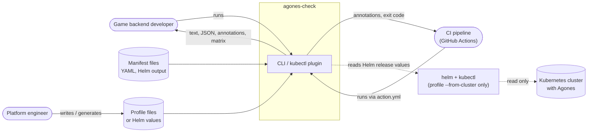
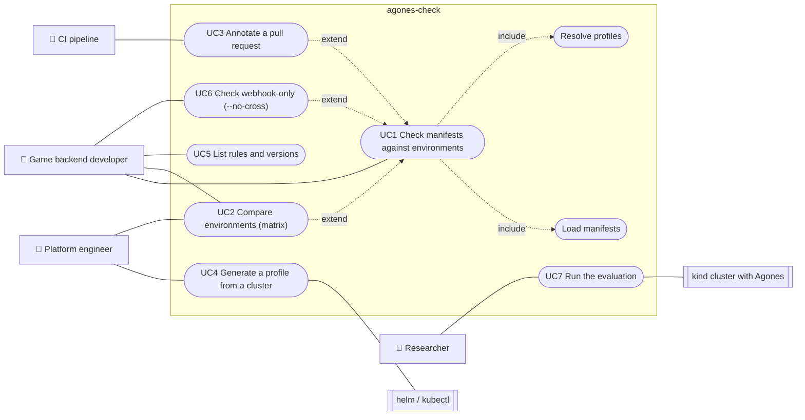
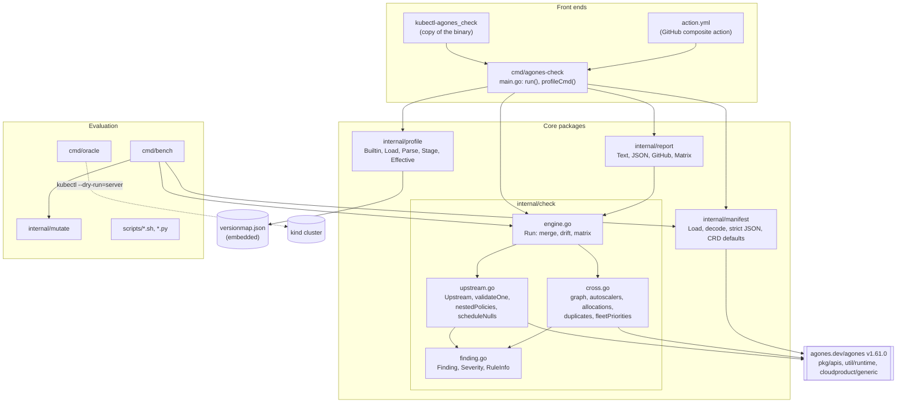
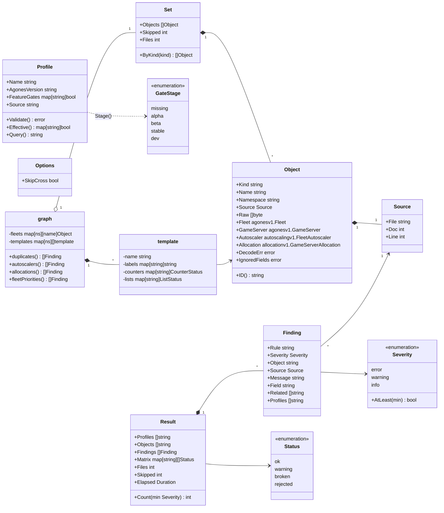
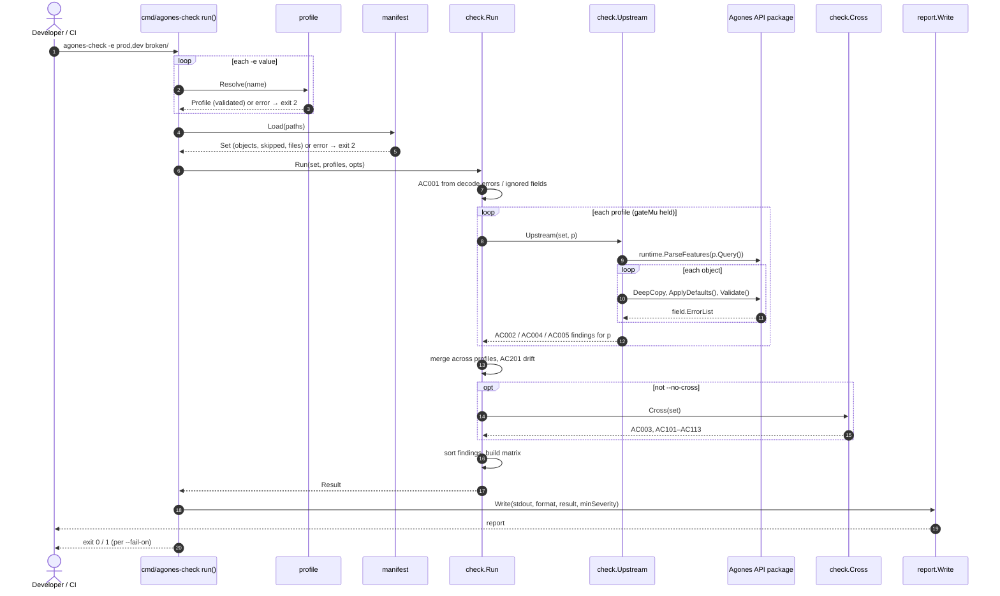
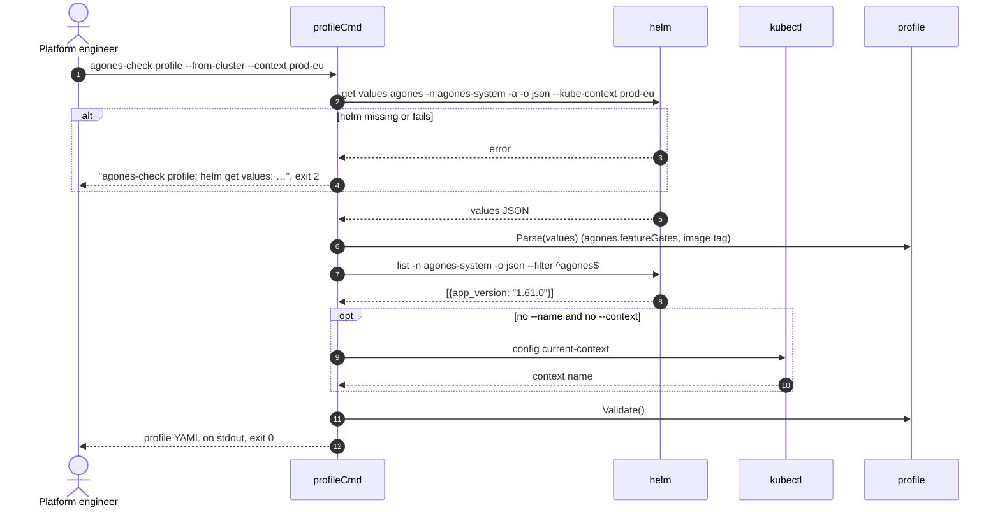
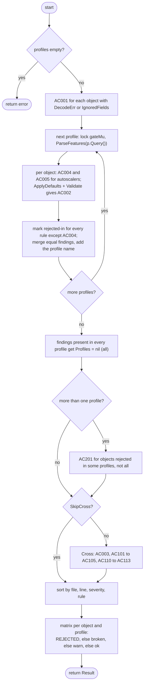
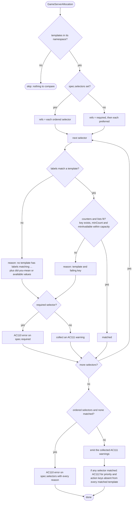
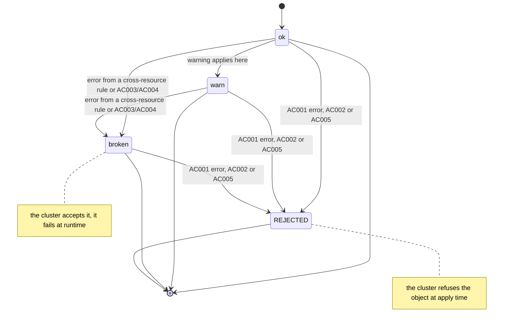
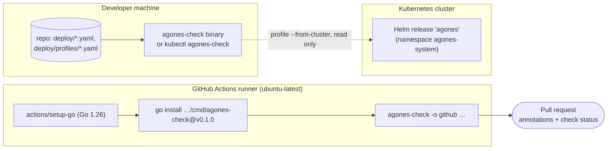

# agones-check: Software Requirements Specification

| | |
|---|---|
| Product | agones-check v0.1.0 (links Agones 1.61.0 validation code) |
| Document | Software Requirements Specification (SRS), as built |
| Course | ENGR5510G Foundations of Software Engineering, Fall 2026, applied track |
| Status | Describes the implementation at commit `2aaa1cb` on `main` |

This SRS describes what agones-check **does today**. It was written from the source code, the tests and the
evaluation results in this repository. Every requirement has a pointer to the code that implements it and acceptance
criteria with a test or a command that checks it. Where the code and an intended behaviour differ, the difference is
listed in [section 8](#8-gaps-found-while-writing-this-srs) instead of being written as a requirement.

## Contents

1. [Introduction](#1-introduction)
2. [Overall description](#2-overall-description)
3. [External interface requirements](#3-external-interface-requirements)
4. [Functional requirements and acceptance criteria](#4-functional-requirements-and-acceptance-criteria)
5. [Non-functional requirements](#5-non-functional-requirements)
6. [UML models](#6-uml-models)
7. [Traceability](#7-traceability)
8. [Gaps found while writing this SRS](#8-gaps-found-while-writing-this-srs)
9. [How to verify this document](#9-how-to-verify-this-document)

---

## 1. Introduction

### 1.1 Purpose

This document specifies the requirements of agones-check, a static checker for [Agones](https://agones.dev)
manifests. It is written for the project team, the course instructor, and anyone who wants to change the tool and
needs to know which behaviour is required and how it is tested.

### 1.2 Scope

Agones runs game servers on Kubernetes. A game backend describes its servers with linked resources (Fleet,
GameServer, FleetAutoscaler, GameServerAllocation) and deploys the same manifests to clusters whose Agones version and
feature gates differ. Agones' admission webhook validates **one object against one cluster** at apply time, so three
classes of mistake get through and only fail at runtime:

1. **Broken links between objects**: an autoscaler's `fleetName` or Counter key, or an allocation's label selector,
   that matches nothing.
2. **Environment differences**: a field valid where a feature gate is on (dev) and rejected where it is off (prod).
3. **Upstream gaps**: values the webhook does not validate (policies nested in a Schedule) or rejects despite the
   documentation (an unset Schedule `between.end`).

agones-check loads a whole manifest set offline, runs Agones' own validation once per target environment, and adds
cross-resource and cross-environment checks. It ships as a CLI, a kubectl plugin and a GitHub Action.

**Out of scope:** runtime monitoring; checking non-Agones Kubernetes resources (that is kubeconform's job); rendering
Helm charts or templated values; modifying any cluster. The only command that contacts a cluster is
`profile --from-cluster`, which reads the Agones Helm release.

### 1.3 Definitions

| Term | Meaning |
|---|---|
| Manifest set | All Agones objects loaded from the paths given on one command line |
| Object ID | `Kind/namespace/name`, for example `Fleet/game/ranked` |
| Environment / profile | A name, an Agones version and feature-gate overrides (`internal/profile`) |
| Feature gate | Agones switch; stages alpha (off by default), beta (on by default), stable (always on) |
| Upstream validation | Agones' `ApplyDefaults()` + `Validate()` Go methods, called the way the webhook calls them |
| Finding | One problem: rule, severity, object, source location, field, message, related objects, environments |
| Error / warning | Error: will fail wherever the finding applies. Warning: likely mistake or depends on things outside the input |
| Drift | An object accepted in some environments and rejected in others (rule AC201) |
| Matrix | Status of every object in every environment: `ok`, `warn`, `broken`, `REJECTED` |
| Template | What a GameServer from a Fleet (or a standalone GameServer) looks like at allocation time: labels, counters, lists |
| Mutant | A valid scenario with one seeded change, used by the evaluation |
| Oracle | A real kind cluster answering `kubectl --dry-run=server` for every mutant |

### 1.4 References

- Proposal and final report: *agones-check*, ENGR5510G, Fall 2026 (requirements R1 to R5, research questions RQ1 to RQ4).
- [`README.md`](../README.md): install, usage, evaluation commands.
- [`docs/rules.md`](rules.md): invalid and corrected example for every rule.
- Agones 1.61.0 source: `pkg/apis/{agones,autoscaling,allocation}/v1`, `test/upgrade/versionMap.yaml`.
- ISO/IEC/IEEE 29148:2018, *Requirements engineering* (structure of this document).

### 1.5 Requirement notation

Each requirement has an ID (`FR-<area>-<n>` or `NFR-<n>`), a "shall" statement, a priority (all implemented
requirements are **Must**), its source among the report's high-level requirements, and the code that implements it.

Acceptance criteria use Given / When / Then and name what verifies them:

- `TestName` is a Go test in this repository (`go test ./...`).
- `$ command` is a command run from the repository root after `go build -o bin/agones-check ./cmd/agones-check`.
- `bench/results/<file>` is a committed evaluation result regenerated by a `make` target.

High-level requirements from the report (section "Requirements"):

| ID | Requirement |
|---|---|
| R1 | **Same rules as upstream.** Per-object results match the real webhook of each Agones version and gate set, without re-implementing Agones' validation. |
| R2 | **Cross-resource.** Check references, keys, capacities and allocation satisfiability across all objects given as input. |
| R3 | **Multi-environment.** Check one manifest set against several environments in one run and report where they disagree. |
| R4 | **CI speed.** Under 2 s for 200 manifests and 3 environments, with no cluster needed. |
| R5 | **Explainable.** Every finding names the file, line, field, objects and environments involved, why it fails at runtime, and a likely fix. |

---

## 2. Overall description

### 2.1 Product perspective

agones-check is a standalone Go binary. It imports Agones' API packages (`agones.dev/agones v1.61.0`) as a library
and never runs inside a cluster.



### 2.2 Product functions

| Function | Summary |
|---|---|
| F1 Load | Read YAML files, directories or stdin; decode Agones kinds strictly into Agones' Go types; apply CRD defaults |
| F2 Environments | Resolve built-in or file profiles to a full feature-gate set for a given Agones version |
| F3 Upstream validation | Run Agones' own defaulting and validation per object, once per environment (AC002), plus two upstream-gap rules (AC004, AC005) |
| F4 Cross-resource checks | Link objects into a graph and check names, keys, capacities, selectors and duplicates (AC003, AC101 to AC113) |
| F5 Cross-environment analysis | Merge findings across environments, report drift (AC201), build the object × environment matrix |
| F6 Reporting | Text, JSON, GitHub workflow annotations, Markdown matrix; severity filter |
| F7 Integration | Exit codes for CI, kubectl plugin, GitHub Action, profile generation from a live cluster |
| F8 Evaluation support | Mutation benchmark, cluster oracle, runtime e2e cases, performance benchmark, real-world corpus |

### 2.3 Users

| User | Goal | Main interface |
|---|---|---|
| Game backend developer | Find mistakes before opening or merging a pull request | CLI, kubectl plugin |
| Reviewer / CI pipeline | Block or annotate a pull request automatically | GitHub Action, `-o github`, exit code |
| Platform engineer | Describe each cluster's Agones version and gates | Profile files, `profile --from-cluster` |
| Researcher / evaluator | Measure detection, false alarms, speed, agreement with real clusters | `make bench`, `make oracle`, `make e2e`, `make perf` |

### 2.4 Operating environment

- Go 1.26 to build; the binary runs on any OS and architecture Go supports. CI runs on `ubuntu-latest`.
- No cluster, network or credentials are needed for checking.
- `profile --from-cluster` needs `helm` on `PATH` and, unless `--name` is given, `kubectl`.
- Evaluation against a cluster needs kind and Agones installed with Helm (see the README).

### 2.5 Design and implementation constraints

| ID | Constraint |
|---|---|
| C1 | Per-object validation must call Agones' code, not a copy of its rules (R1). The linked version is 1.61.0 (`profile.CheckerVersion`). |
| C2 | Agones keeps feature gates in a package-level variable, so environments are validated one at a time under a mutex (`check.gateMu`). |
| C3 | Older-version profiles change gate defaults, not the validation code. A check that changed between Agones versions is evaluated with 1.61 semantics. |
| C4 | Only what is known before deployment is used. Counter and list *values* change at runtime; capacity and key checks use declared capacities and keys. |

### 2.6 Assumptions and dependencies

- A1. Objects without `metadata.namespace` are deployed to `default`, as `kubectl apply` does without `-n`.
- A2. The manifest set given to one run is everything that will be deployed together. A FleetAutoscaler whose
  namespace has no Fleet in the input may target a Fleet deployed elsewhere, so that case is a warning, not an error.
- A3. Gate stages per Agones version come from Agones' `test/upgrade/versionMap.yaml`, embedded as
  `internal/profile/versionmap.json`.
- A4. Templated values (`$CA_BUNDLE`, Helm templates) are rendered before checking.

---

## 3. External interface requirements

### 3.1 Command-line interface

```text
agones-check [flags] PATH...           check manifests (files, directories, or - for stdin)
agones-check profile --from-cluster    print an environment profile read from the current cluster
agones-check rules                     list the rules
agones-check versions                  list the Agones versions profiles can target
agones-check version
```

| Flag | Values | Default |
|---|---|---|
| `-e`, `--env` | profile file path or built-in name; repeatable and comma-separated | `prod` |
| `-o` | `text`, `json`, `github`, `matrix` | `text` |
| `--fail-on` | `error`, `warning`, `never` | `error` |
| `--min-severity` | `error`, `warning`, `info` | `warning` |
| `--no-cross` | boolean: only Agones' per-object validation | `false` |

`profile` flags: `--from-cluster` (required), `--name`, `--namespace` (default `agones-system`), `--release`
(default `agones`), `--context`.

**Exit status**

| Code | Meaning |
|---|---|
| 0 | No finding at or above the `--fail-on` severity (always 0 with `--fail-on never`); `-h` |
| 1 | At least one finding at or above the `--fail-on` severity |
| 2 | Usage or input error: no paths, unknown or repeated environment, invalid profile, unreadable path, invalid YAML, unknown output format, invalid `--fail-on` |

### 3.2 Input formats

**Manifests.** YAML files with one or more documents separated by `---`. Recognised kinds (by API group):

| apiVersion group | Kind | Decoded into |
|---|---|---|
| `agones.dev` | `Fleet`, `GameServer` | `agonesv1.Fleet`, `agonesv1.GameServer` |
| `autoscaling.agones.dev` | `FleetAutoscaler` | `autoscalingv1.FleetAutoscaler` |
| `allocation.agones.dev` | `GameServerAllocation` | `allocationv1.GameServerAllocation` |

Any other document is skipped and counted.

**Profiles.** A profile file:

```yaml
name: staging            # optional; defaults to the file name without extension
agonesVersion: "1.61"    # optional; defaults to 1.61.0
featureGates:            # optional overrides of that version's defaults
  PlayerAllocationFilter: true
```

or a Helm values file, from which `agones.featureGates` (`"A=true&B=false"`) and `agones.image.tag` are read.

### 3.3 Output formats

| Format | Content |
|---|---|
| `text` | One block per finding: `file:line field: SEVERITY RULE [object] (env: …)` and an indented message; then a summary line `N objects from F files (S non-Agones documents skipped), E environments (…): X errors, Y warnings in T` |
| `json` | The full `Result`: `profiles`, `objects`, `findings`, `matrix`, `files`, `skippedDocuments`, `elapsedNs` |
| `github` | One workflow command per finding, `::error` / `::warning` / `::notice file=…,line=…,title=RULE object (env: …)::message`, then the text output |
| `matrix` | Markdown table of object × environment status with a legend line |

### 3.4 GitHub Action (`action.yml`)

| Input | Required | Default | Meaning |
|---|---|---|---|
| `paths` | yes | | space-separated files or directories |
| `environments` | no | `prod` | comma-separated profiles |
| `fail-on` | no | `error` | passed to `--fail-on` |
| `version` | no | `v0.1.0` | release tag to `go install` |
| `install-from-source` | no | `false` | build from the action's own checkout instead |

The action sets up Go 1.26, installs the binary and runs
`agones-check -o github -e "<environments>" --fail-on "<fail-on>" <paths>`.

### 3.5 kubectl plugin

`make build` writes `bin/agones-check` and a copy named `bin/kubectl-agones_check`; `make plugin` copies the latter
into `$(go env GOPATH)/bin`, so `kubectl agones-check …` runs the same program. `plugins/agones-check.yaml` is a Krew
manifest template for future release archives.

---

## 4. Functional requirements and acceptance criteria

### 4.1 Loading manifests (FR-LOAD)

Implemented in `internal/manifest/manifest.go`.

#### FR-LOAD-1 Read files, directories and standard input

The system shall accept any number of paths, read a file path directly, walk a directory recursively for files ending
in `.yaml` or `.yml` (case-insensitive) in sorted order, and read standard input when the path is `-`.
*Source:* R2. *Code:* `Load`, `yamlFiles`.

- **AC-LOAD-1.1** Given `testdata/backend` (13 YAML files in subdirectories), when it is loaded, then 13 files and 26
  objects are read. *Verified by* `TestLoadDirectory`.
- **AC-LOAD-1.2** Given two Agones objects piped on stdin, when `agones-check -` runs, then the summary reports
  `2 objects` and exit code 0. *Verified by* `TestStdin`.
- **AC-LOAD-1.3** Given a path that does not exist, when it is checked, then the tool prints
  `agones-check: stat <path>: no such file or directory` and exits 2. *Verified by* `TestUsageErrors`.

#### FR-LOAD-2 Split documents and record their location

The system shall split each file on `---` (also `--- …` and `...`) lines, drop documents that contain only comments
or whitespace, and record for each object the file, the 0-based document index and the 1-based line of the
document's first content line.
*Source:* R5. *Code:* `splitDocs`, `Source`.

- **AC-LOAD-2.1** Given a file whose Fleet starts at line 3 and whose allocation starts at line 28, when it is
  loaded, then their `Source.Line` values are 3 and 28. *Verified by* `TestLoadBytes`.
- **AC-LOAD-2.2** Given a Service document followed by a comment-only document on stdin, when it is checked, then the
  summary reads `0 objects from 1 files (1 non-Agones documents skipped)`.
  *Verified by* `$ printf 'apiVersion: v1\nkind: Service\nmetadata: {name: s}\n---\n# only a comment\n' | bin/agones-check -`.

#### FR-LOAD-3 Recognise Agones kinds and skip the rest

The system shall decode a document only when its API group and kind are one of the four in
[3.2](#32-input-formats), skip every other valid document, and count skipped documents.
*Code:* `decode`.

- **AC-LOAD-3.1** Given a file with one Fleet, one GameServerAllocation and one non-Agones document, when it is loaded,
  then 2 objects are kept and `Skipped` is 1. *Verified by* `TestLoadBytes`.

#### FR-LOAD-4 Identify objects

The system shall identify each object as `Kind/namespace/name`, using `metadata.generateName` when `metadata.name` is
empty and `default` when `metadata.namespace` is empty.
*Code:* `Object.ID`, `DefaultNamespace`.

- **AC-LOAD-4.1** Given a Fleet without a namespace and an allocation with `generateName: lobby-` in namespace `game`,
  when they are loaded, then their IDs are `Fleet/default/lobby` and `GameServerAllocation/game/lobby-`.
  *Verified by* `TestLoadBytes`.

#### FR-LOAD-5 Strict decoding

The system shall decode Agones objects the way the API server does under kubectl's default strict field validation:
field names are case-sensitive, and unknown fields, duplicate fields and wrongly typed values are errors.
*Source:* R1. *Code:* `strictUnmarshal`.

- **AC-LOAD-5.1** Given a Fleet with `replica: 2`, `Replicas: 2` or `replicas` set twice, when it is loaded, then the
  object has a decode error (or, for the duplicate key, loading fails with "already set"). *Verified by* `TestStrictDecode`.
- **AC-LOAD-5.2** Given a Fleet with `replica: 2`, when it is checked, then an `AC001` error with
  `unknown field "spec.replica"` is reported. *Verified by* `TestRules/unknown field`.

#### FR-LOAD-6 Allocation fields the API ignores

For a GameServerAllocation whose only decode problem is unknown fields, the system shall keep the decoded object and
record the unknown fields separately, because the allocation API (an aggregated API) drops unknown fields instead of
rejecting them.
*Source:* R1. *Code:* `strictUnmarshalSplit`, `Object.IgnoredFields`.

- **AC-LOAD-6.1** Given an allocation selector with an unknown `players` field, when it is checked, then an `AC001`
  **warning** says the field is silently dropped, no object is marked `REJECTED`, and the allocation still matches its
  Fleet. *Verified by* `TestRules/unknown allocation field is dropped`, `TestIgnoredAllocationFieldIsNotRejected`.

#### FR-LOAD-7 CRD defaults for capacities

The system shall set a Counter or List capacity that is missing or `null` in a Fleet template or GameServer to 1000,
as the Agones CRD schema does on the API server, and keep explicit capacities.
*Source:* R2. *Code:* `applyCRDDefaults`, `CRDDefaultCapacity`.

- **AC-LOAD-7.1** Given a Fleet with a counter without capacity, a list with `capacity: null` and a list with
  `capacity: 4`, when it is loaded, then the capacities are 1000, 1000 and 4. *Verified by* `TestCRDDefaultCapacity`.

#### FR-LOAD-8 Invalid YAML is an input error

The system shall stop with an error naming the file and line when a document is not valid YAML.

- **AC-LOAD-8.1** Given invalid YAML, when it is loaded, then `LoadBytes` returns an error. *Verified by* `TestInvalidYAML`.
- **AC-LOAD-8.2** Given `a: [` on stdin, when it is checked, then the tool prints
  `agones-check: <stdin>:1: invalid YAML: …` and exits 2. *Verified by* `$ printf 'a: [\n' | bin/agones-check -`.

### 4.2 Environment profiles (FR-PROF)

Implemented in `internal/profile/profile.go`.

#### FR-PROF-1 Built-in profiles

The system shall provide these built-in profiles:

| Name | Agones version | Gates |
|---|---|---|
| `prod` | 1.61.0 | version defaults (beta and stable on, alpha off) |
| `dev` | 1.61.0 | defaults plus `PlayerAllocationFilter`, `PlayerTracking`, `WasmAutoscaler` on |
| `beta-off` | 1.61.0 | defaults with `CountsAndLists`, `GKEAutopilotExtendedDurationPods`, `ScheduledAutoscaler`, `SidecarContainers`, `FleetAutoscaleRequestMetaData` off |
| `1.NN[.P]` | that version | that version's defaults |

*Source:* R3. *Code:* `Builtin`.

- **AC-PROF-1.1** Given the names `prod`, `dev`, `beta-off`, `1.54` and `1.40.0`, when each is resolved, then no
  error occurs; given `staging` (no such file or built-in), then an error lists the built-ins. *Verified by* `TestBuiltin`.
- **AC-PROF-1.2** Given `-e staging2`, when the CLI runs, then it prints
  `unknown profile "staging2" (built-ins: prod, dev, beta-off, or an Agones version such as 1.54)` and exits 2.
  *Verified by* `TestUsageErrors` (`-e nope`).

#### FR-PROF-2 Profile files and Helm values

The system shall treat an `-e` value that names an existing file as a profile file, accept either the profile format
or a Helm values file (`agones.featureGates`, `agones.image.tag`), default the name to the file name and the version
to 1.61.0.
*Source:* R3. *Code:* `Resolve`, `Load`, `Parse`, `ParseGateString`.

- **AC-PROF-2.1** Given a plain profile and a Helm values file with `featureGates: "WasmAutoscaler=true&CountsAndLists=false"`
  and `image.tag: 1.59.0`, when they are parsed, then the gates and version are read; `A=maybe` is rejected.
  *Verified by* `TestParse`.
- **AC-PROF-2.2** Given `-e examples/profiles/staging.yaml,examples/profiles/prod-1.59.yaml -o matrix`, when
  `testdata/backend/ranked` is checked, then the matrix header is `| Object | staging | prod-1.59 |` and the exit code is 0.
  *Verified by* `TestProfileFile`, `TestLoadFile`.

#### FR-PROF-3 Gate stages per version

The system shall know, for each Agones version in the embedded version map, the stage of each of the 15 gates Agones
1.61 understands: `missing`, `alpha`, `beta`, `stable` (existed earlier, no longer listed) or `dev`.
*Source:* R3, C3. *Code:* `Stage`, `knownGates`, `versionmap.json`.

- **AC-PROF-3.1** `CountsAndLists` is beta in 1.61 and alpha in 1.40; `WasmAutoscaler` is alpha in 1.54 and missing
  in 1.53; `PortRanges` is stable in 1.61 and missing in 1.40; `ProcessorAllocator` is dev. *Verified by* `TestStage`.

#### FR-PROF-4 Effective gate set

The system shall compute a profile's effective gates as: beta and stable gates on, all others off, then the profile's
overrides applied; and pass them to Agones in its `A=true&B=false` format.
*Code:* `Effective`, `Query`.

- **AC-PROF-4.1** For version 1.40, `CountsAndLists` and `ScheduledAutoscaler` are off and `DisableResyncOnSDKServer`
  is on; for 1.61 with `WasmAutoscaler: true`, both `WasmAutoscaler` and `CountsAndLists` are on. *Verified by* `TestEffective`.

#### FR-PROF-5 Profile validation

The system shall reject a profile whose version is not in the version map, that names an unknown gate, that turns on
a gate missing in its version, or that turns off a gate that is stable in its version.
*Code:* `Profile.Validate`.

- **AC-PROF-5.1** Profiles with version `9.99`, gate `NoSuchGate`, `WasmAutoscaler: true` on 1.53, or
  `PortRanges: false` on 1.61 fail validation; `v1.61.0` with `CountsAndLists: false` passes. *Verified by* `TestValidate`.

#### FR-PROF-6 Distinct environments

The system shall refuse to run when two `-e` values resolve to the same profile name.

- **AC-PROF-6.1** Given `-e prod,prod`, when the CLI runs, then it prints `environment "prod" given twice` and exits 2.
  *Verified by* `TestUsageErrors`.

#### FR-PROF-7 List supported versions

The `versions` command shall print every Agones version in the version map, oldest first.

- **AC-PROF-7.1** `agones-check versions` exits 0 and its output contains `1.61.0`. *Verified by* `TestSubcommands`.
  At commit `2aaa1cb` it prints 22 versions, `1.40.0` to `1.61.0`.

### 4.3 Per-object validation (FR-VAL)

Implemented in `internal/check/upstream.go`.

#### FR-VAL-1 Run Agones' own validation per environment

For every environment, the system shall switch Agones' feature gates to that environment's effective set and, for
each decoded object, apply Agones' defaults to a copy and call its `Validate` method, exactly as the webhook handlers
do (Fleet and GameServer with the generic cloud-product hooks). Each returned field error shall become an `AC002`
error with the field path and the environment.
*Source:* R1. *Code:* `Upstream`, `validateOne`.

- **AC-VAL-1.1** Given a Buffer autoscaler with `bufferSize: 5` and `maxReplicas: 10` that Agones rejects, when it is
  checked, then `AC002` is reported. *Verified by* `TestRules/upstream validation`.
- **AC-VAL-1.2** Given the 261 benchmark mutants, when the offline dry-run baselines are compared with a real kind
  cluster running Agones 1.61.0 (default gates and every alpha gate on) and one running Agones 1.54.0, then the
  accepted/rejected verdict agrees on 261 of 261 in each case.
  *Verified by* `bench/results/oracle.md`, `oracle-dev.md`, `oracle-1.54.md` (`make oracle`, `make oracle-dev`,
  `make oracle-version V=1.54`).

#### FR-VAL-2 Webhook-only mode

With `--no-cross`, the system shall report only what the webhook itself reports: decoding problems, `AC002`, `AC005`
and drift. It shall skip cross-resource rules and `AC004`.
*Source:* R1 (baseline for the evaluation). *Code:* `Options.SkipCross`.

- **AC-VAL-2.1** Given a Fleet and an autoscaler with `fleetName: rankd`, when checked with `SkipCross`, then there
  are no findings. *Verified by* `TestSkipCrossIsWebhookOnly`.

#### FR-VAL-3 Validate policies nested in a Schedule (AC004)

The system shall validate the policy inside every Schedule policy (also inside Chain entries) with Agones'
`ValidatePolicy` and report each error as `AC004`, because Agones' webhook does not validate nested policies.
*Source:* R1 (upstream gap). *Code:* `nestedPolicies`.

- **AC-VAL-3.1** Given a Schedule policy wrapping an invalid Buffer policy, when it is checked, then `AC004` error is
  reported. *Verified by* `TestRules/nested schedule policy`.
- **AC-VAL-3.2** On a cluster, such an autoscaler is accepted and scales the Fleet down to the invalid bound.
  *Verified by* `bench/results/e2e.md` case `fas-nested-schedule` (`make e2e`).

#### FR-VAL-4 Unset Schedule window (AC005)

The system shall report `AC005` when a Schedule policy (at any nesting depth) leaves `between.start` or `between.end`
unset, with a suggested value, because Agones' mutating webhook writes the unset time as `null` and the API server
rejects it.
*Source:* R1 (upstream bug). *Code:* `scheduleNulls`.

- **AC-VAL-4.1** Given a Schedule without `between.end`, or a Chain entry with a Schedule without `between.start`,
  when it is checked, then `AC005` error is reported. *Verified by* `TestRules/schedule without end`,
  `TestRules/chain schedule without start`.
- **AC-VAL-4.2** A real cluster rejects the first case at `--dry-run=server`. *Verified by* `bench/results/e2e.md`
  case `fas-schedule-no-end`.

#### FR-VAL-5 One environment at a time

The system shall hold a process-wide lock while an environment's gates are active, so validation for two environments
never interleaves.
*Source:* C2. *Code:* `gateMu`.

- **AC-VAL-5.1** `go test -race ./...` passes (run in CI, `.github/workflows/ci.yml`).

### 4.4 Cross-resource checks (FR-XR)

Implemented in `internal/check/cross.go`. These checks do not depend on the environment and are skipped with
`--no-cross`. The graph indexes Fleets by namespace and name, and builds one template per Fleet (its template labels
plus the `agones.dev/fleet: <name>` label the Fleet controller adds) and per standalone GameServer.

#### FR-XR-1 Duplicate objects (AC003)

The system shall report an `AC003` error when two documents define the same object ID, naming the first location,
except for GameServerAllocations and objects named with `generateName`.
*Code:* `graph.duplicates`.

- **AC-XR-1.1** Given the same Fleet twice, when it is checked, then `AC003` says it is "also defined" at the first
  location. *Verified by* `TestRules/duplicate fleet`.

#### FR-XR-2 Autoscaler target exists (AC101)

For each FleetAutoscaler with a non-empty `fleetName`, the system shall report `AC101` when no Fleet of that name
exists in the autoscaler's namespace: an **error** with a "did you mean" suggestion when the namespace has other
Fleets in the input, a **warning** when it has none (the Fleet may be deployed elsewhere).
*Source:* R2, R5. *Code:* `graph.autoscalers`, `graph.missingFleet`.

- **AC-XR-2.1** Given Fleet `ranked` and `fleetName: rankd`, then `AC101` error contains `did you mean "ranked"`.
  *Verified by* `TestRules/fleet ref typo`.
- **AC-XR-2.2** Given only an autoscaler for `lobby` and no Fleet in its namespace, then `AC101` is a warning.
  *Verified by* `TestRules/fleet ref, no fleets in input`, `TestGitHubWarning`.
- **AC-XR-2.3** On a cluster, the typo is accepted and the autoscaler logs `FailedGetFleet`.
  *Verified by* `bench/results/e2e.md` case `fas-fleetname-typo`.

#### FR-XR-3 Counter and List policy keys (AC102, AC103)

For each Counter or List policy of an autoscaler whose Fleet is in the input, including policies nested in Schedule
and Chain policies, the system shall report an error when the key is not defined in the Fleet template, listing the
available keys and a suggestion.
*Source:* R2. *Code:* `policies`, `graph.autoscalers`.

- **AC-XR-3.1** Counter key `room` against counter `rooms` gives `AC102`; list key `player` gives `AC103`; a wrong
  counter key inside a Chain gives `AC102`. *Verified by* `TestRules/counter key typo`, `list key typo`,
  `nested counter key in chain`.
- **AC-XR-3.2** `TestFindingsExitOne` checks that an `AC102` finding makes the CLI exit 1.

#### FR-XR-4 Reachable capacity bounds (AC104)

When a Counter or List policy's key exists, the system shall warn (`AC104`) if the per-GameServer capacity is not
positive or if the policy's `maxCapacity` is below the per-GameServer capacity.
*Code:* `capacityCheck`.

- **AC-XR-4.1** Given `maxCapacity: 2` with a per-server counter capacity above 2, then `AC104` warning.
  *Verified by* `TestRules/capacity below one server`.
- **AC-XR-4.2** Agones' own `examples/listfleetautoscaler` (maxCapacity 100, default list capacity 1000) gets the
  same warning. *Verified by* `bench/results/mutation.md`, scenario `example-list`.

#### FR-XR-5 One autoscaler per Fleet (AC105)

The system shall warn (`AC105`) on every additional FleetAutoscaler that targets a Fleet already targeted by another,
counting an autoscaler defined twice under one name as one.
*Code:* `graph.autoscalers`.

- **AC-XR-5.1** Two differently named autoscalers for one Fleet give `AC105`. *Verified by* `TestRules/two autoscalers`.
- **AC-XR-5.2** One autoscaler defined twice gives `AC003` and no `AC105`.
  *Verified by* `TestDuplicateAutoscalerIsNotASecondAutoscaler`.

#### FR-XR-6 Allocation can be satisfied (AC110, AC111)

For each GameServerAllocation whose namespace has templates in the input, the system shall decide for each selector
whether some template matches its labels and can satisfy its counter and list conditions (key exists,
`minCount` and `minAvailable` not above capacity). It shall report:

- `AC110` error when the `required` selector matches nothing, or when `selectors` (ordered) is used and none matches;
- `AC111` warning for each `preferred` or ordered selector that matches nothing while another selector does;
- in both cases the reason, and for a label value within edit distance 2 of an existing one, a "did you mean" hint
  (otherwise the available values for that label).

*Source:* R2, R5. *Code:* `graph.allocations`, `matchTemplates`, `countersFit`, `listsFit`, `labelHint`.

- **AC-XR-6.1** `required` selector `mode: rankd` against Fleet `mode: ranked` gives `AC110` error.
  *Verified by* `TestRules/required selector label typo`.
- **AC-XR-6.2** All ordered selectors dead gives `AC110`; one of two dead gives `AC111`; a dead `preferred` gives
  `AC111`. *Verified by* `TestRules/all ordered selectors dead`, `one ordered selector dead`, `preferred dead`.
- **AC-XR-6.3** A selector counter key that does not exist, a list `minAvailable` above capacity, or a counter
  `minCount` above capacity gives `AC110`. *Verified by* `TestRules/selector counter missing`,
  `selector list over capacity`, `selector counter over capacity`.
- **AC-XR-6.4** For the demo's `broken/allocation.yaml`, the message contains `(mode="rankd": did you mean "ranked"?)`
  for both selectors. *Verified by* `$ bin/agones-check -e prod,dev <demo>/broken`.
- **AC-XR-6.5** On a cluster, label and counter typos make allocations return `UnAllocated` and the control case
  returns `Allocated`. *Verified by* `bench/results/e2e.md` cases `gsa-label-typo`, `gsa-counter-typo`, `gsa-control`.

#### FR-XR-7 Allocation keys (AC112)

For an allocation with at least one matching template, the system shall warn (`AC112`) for each Counter or List
priority, counter action or list action whose key is absent from every matching template.
*Code:* `allocationKeys`.

- **AC-XR-7.1** A counter action on unknown `seats` and a List priority on unknown `teams` each give `AC112`.
  *Verified by* `TestRules/action on unknown counter`, `priority on unknown list`.

#### FR-XR-8 Fleet priorities (AC113)

The system shall warn (`AC113`) when a Fleet's Counter or List priority names a key its template does not define.
*Code:* `graph.fleetPriorities`.

- **AC-XR-8.1** A Fleet priority on unknown counter `seats` gives `AC113`. *Verified by* `TestRules/fleet priority unknown key`.

#### FR-XR-9 Suggestions

The system shall suggest the closest candidate name when it is within Levenshtein distance 2 and not identical.
*Code:* `suggest`, `editDistance`.

- **AC-XR-9.1** `editDistance("rooms", "room")` is 1; `suggest("abc", ["xyz"])` is empty. *Verified by* `TestEditDistance`.

### 4.5 Cross-environment analysis (FR-ENV)

Implemented in `internal/check/engine.go`.

#### FR-ENV-1 Merge findings across environments

The system shall merge identical findings (same object, rule, field and message) from different environments into
one finding listing those environments, and list no environment ("all") when it applies to every environment checked.
*Source:* R3, R5. *Code:* `Run`, `Finding.key`.

- **AC-ENV-1.1** A finding present in every environment is printed with `(env: all)`; one present in only some is
  printed with those names, e.g. `(env: prod)`. *Verified by* `TestText`, `TestDriftAndMatrix`.

#### FR-ENV-2 Drift (AC201)

When more than one environment is checked, the system shall report an `AC201` warning for each object rejected in
some environments and accepted in others, naming both groups. Rejection here means an `AC002` or `AC005` finding.
*Source:* R3. *Code:* `Run`.

- **AC-ENV-2.1** A Wasm autoscaler checked with `prod,dev` gives `AC002` in prod only and an `AC201` warning
  "accepted in dev but rejected in prod". *Verified by* `TestDriftAndMatrix`.
- **AC-ENV-2.2** A Counter policy checked with `prod,1.40` gives `AC201` for `1.40` (CountsAndLists was alpha there).
  *Verified by* `TestOlderVersionProfile`.
- **AC-ENV-2.3** With one environment, no `AC201` is produced.

#### FR-ENV-3 Object × environment matrix

The system shall compute, for every object and environment, one status:

| Status | When |
|---|---|
| `REJECTED` | a schema error (`AC001` error), `AC002` or `AC005` applies there |
| `broken` | otherwise, an error from another rule applies there (accepted but fails at runtime) |
| `warn` | otherwise, a warning applies there |
| `ok` | no finding applies |

*Source:* R3. *Code:* `Run` (matrix block), `Status`.

- **AC-ENV-3.1** The Wasm autoscaler's row is `[REJECTED ok]` for `prod,dev`, and the Fleet's row is `ok`.
  *Verified by* `TestDriftAndMatrix`.
- **AC-ENV-3.2** An allocation with a dead `required` selector is `broken`. *Verified by* `TestMatrixBroken`.
- **AC-ENV-3.3** `testdata/backend/ranked` with `-e prod -e dev,beta-off -o matrix` shows every object `ok | ok | REJECTED`.
  *Verified by* `$ bin/agones-check -e prod -e dev,beta-off -o matrix testdata/backend/ranked`.

#### FR-ENV-4 At least one environment

The engine shall return an error when called with no environments. (The CLI always passes at least `prod`.)

- **AC-ENV-4.1** *Verified by* `TestNoProfiles`.

#### FR-ENV-5 Deterministic order

The system shall sort findings by file, then line, then severity (errors first), then rule ID.
*Code:* `sortFindings`.

- **AC-ENV-5.1** In the demo run, findings print in the order `allocation.yaml:2 AC110`, `fleet.yaml:2 AC002`,
  `fleet.yaml:2 AC201`, `fleet.yaml:42 AC101`. *Verified by* `$ bin/agones-check -e prod,dev <demo>/broken`.

### 4.6 Reporting (FR-OUT)

Implemented in `internal/report/report.go`.

#### FR-OUT-1 Text report

The system shall print each finding as `file:line[ field]: SEVERITY RULE [object] (env: …)` followed by the message
on an indented line, then a blank line and the summary line defined in [3.3](#33-output-formats).
*Source:* R5.

- **AC-OUT-1.1** Output contains `a.yaml:3: ERROR AC002`, `(env: prod)`, `(env: all)` and `1 errors, 1 warnings`.
  *Verified by* `TestText`.
- **AC-OUT-1.2** A clean run of `testdata/backend` with `prod,dev` contains `0 errors, 0 warnings` and exits 0.
  *Verified by* `TestCleanExitZero`.

#### FR-OUT-2 Severity filter

The system shall print only findings at or above `--min-severity` (default `warning`) in `text`, `json` and `github`
output. The summary counts and the exit code use all findings.

- **AC-OUT-2.1** With `--min-severity error`, an `AC113` warning is not printed. *Verified by* `TestText`.

#### FR-OUT-3 JSON report

The system shall write the full result as indented JSON, with `findings` an empty array (not `null`) when nothing is
reported.

- **AC-OUT-3.1** Decoding the JSON back gives the same findings and matrix. *Verified by* `TestJSON`.
- **AC-OUT-3.2** A clean input gives `"findings": []`. *Verified by* `$ bin/agones-check -o json testdata/backend/ranked`.

#### FR-OUT-4 GitHub annotations

The system shall write one GitHub workflow command per finding: `::error` for errors, `::warning` for warnings,
`::notice` for info, with `file`, `line` and a `title` of rule, object and environments; it shall escape `%`, CR and
LF in the message and also `:` and `,` in properties; then print the text report.
*Source:* R5.

- **AC-OUT-4.1** Output contains
  `::error file=a.yaml,line=3,title=AC002 FleetAutoscaler/game/fas (env%3A prod)::Forbidden: feature, with comma`,
  a `::warning` line, and `line1%0Aline2` for a two-line message. *Verified by* `TestGitHub`.
- **AC-OUT-4.2** A warning-only input gives exactly one annotation, no stderr, and exit 0 / 1 / 0 for
  `--fail-on error` / `warning` / `never`. *Verified by* `TestGitHubWarning`.

#### FR-OUT-5 Matrix report

The system shall print the matrix as a Markdown table with one column per environment (in `-e` order), one row per
object (in load order), and the legend
`ok = passes, warn = warning only, broken = accepted but fails at runtime, REJECTED = refused at apply`.

- **AC-OUT-5.1** Output contains `| FleetAutoscaler/game/fas | REJECTED | ok |`. *Verified by* `TestMatrix`.

#### FR-OUT-6 Unknown format

The system shall reject an unknown `-o` value with a message listing the formats, and exit 2.

- **AC-OUT-6.1** *Verified by* `TestUnknownFormat`, `TestUsageErrors` (`-o xml`).

### 4.7 Command line and exit status (FR-CLI)

Implemented in `cmd/agones-check/main.go`.

#### FR-CLI-1 Exit status

The system shall exit with the codes in [3.1](#31-command-line-interface).
*Source:* CI integration.

- **AC-CLI-1.1** Clean input exits 0. *Verified by* `TestCleanExitZero`.
- **AC-CLI-1.2** An error finding exits 1; the same input with `--fail-on never` exits 0. *Verified by* `TestFindingsExitOne`.
- **AC-CLI-1.3** `-e nope`, `-e prod,prod`, `-o xml`, `--fail-on sometimes`, a missing file, and no arguments each
  exit 2. *Verified by* `TestUsageErrors`; `$ bin/agones-check; echo $?` prints `2`.

#### FR-CLI-2 Environment flag

The system shall accept `-e` and `--env`, repeated or comma-separated (blank items ignored), and default to `prod`.
*Code:* `multiFlag`.

- **AC-CLI-2.1** `-e prod -e dev,beta-off` checks three environments in that order. *Verified by* AC-ENV-3.3.

#### FR-CLI-3 Informational subcommands

`rules` shall list every rule ID with its description, sorted; `versions` shall list the supported Agones versions;
`version` shall print `agones-check <version> (Agones validation 1.61.0)`.

- **AC-CLI-3.1** `rules` contains `AC110`, `versions` contains `1.61.0`, `version` contains `agones-check`; all exit 0.
  *Verified by* `TestSubcommands`.

#### FR-CLI-4 Generate a profile from a cluster

`profile --from-cluster` shall read the Agones Helm release (`helm get values <release> -n <namespace> -a -o json`),
take the Agones version from the release's `app_version` (`helm list`), take the name from `--name`, else
`--context`, else `kubectl config current-context`, validate the profile, and print it as YAML. Every failure shall
print a message starting `agones-check profile: ` and exit 2 with no standard output. Without `--from-cluster` the
command shall exit 2.
*Source:* R3. *Code:* `profileCmd`.

- **AC-CLI-4.1** With Helm missing, Helm writing to stderr, Helm exiting 7, invalid values, or an unknown discovered
  version (`99.99.99`), the command exits 2 with an empty stdout and the matching message.
  *Verified by* `TestProfileFromClusterErrors`.
- **AC-CLI-4.2** `agones-check profile` exits 2. *Verified by* `TestSubcommands`.
- **AC-CLI-4.3** Against a cluster with Agones installed by Helm, the output has the shape of
  `examples/profiles/kind.yaml` (`agonesVersion: 1.61.0`, `name: kind-agones-check`). *Verified manually*; needs a cluster.

### 4.8 Integrations (FR-INT)

#### FR-INT-1 kubectl plugin

The build shall produce `kubectl-agones_check`, the same program, so it runs as `kubectl agones-check`.
*Code:* `Makefile` targets `build`, `plugin`.

- **AC-INT-1.1** `make build` creates `bin/agones-check` and `bin/kubectl-agones_check`; after `make plugin`,
  `kubectl agones-check version` prints the version. *Verified manually.*

#### FR-INT-2 GitHub Action

The repository shall provide a composite action with the inputs in [3.4](#34-github-action-actionyml) that installs
the tool and fails the job according to `fail-on`, with findings shown as pull-request annotations.
*Code:* `action.yml`, `examples/github-workflow/`.

- **AC-INT-2.1** CI job `action` runs the action from this repository on `testdata/backend` with
  `prod,dev,1.54` and `install-from-source: "true"` and passes. *Verified by* `.github/workflows/ci.yml`.

#### FR-INT-3 Helm charts

The tool shall check rendered charts from stdin.

- **AC-INT-3.1** `helm template my-game ./chart | agones-check -e prod,dev -` checks the rendered objects
  (stdin path, AC-LOAD-1.2).

### 4.9 Evaluation support (FR-EVAL)

Implemented in `internal/mutate`, `cmd/bench`, `cmd/oracle`, `scripts/`. These exist to answer the report's research
questions; they are not part of the shipped checker.

#### FR-EVAL-1 Mutation operators

The system shall provide 20 mutation operators on generic YAML (15 faulty, 5 benign), each producing one mutant per
place it applies and recording the expected runtime effect.

| Faulty operators | Benign operators |
|---|---|
| `fas-fleetname-typo`, `fas-counter-key-typo`, `fas-list-key-typo`, `alloc-label-typo`, `fleet-label-drift`, `alloc-counter-key-typo`, `alloc-list-key-typo`, `alloc-capacity-unreachable`, `alpha-gated-field`, `unknown-field`, `invalid-bounds`, `duplicate-name`, `fas-schedule-unset-end`, `fas-second-autoscaler`, `fleet-priority-key-typo` | `benign-rename-fleet`, `benign-replicas`, `benign-add-label`, `benign-raise-capacity`, `benign-image-tag` |

- **AC-EVAL-1.1** Every operator produces valid YAML; renaming a Fleet keeps references consistent.
  *Verified by* `TestOperatorsProduceValidYAML`, `TestNewOperatorsApply`, `TestTypo`, `TestRenameKeepsReferences`.

#### FR-EVAL-2 Mutation benchmark (RQ1, RQ2)

`make bench` shall apply every operator to the 18 scenarios in `testdata/bench/scenarios.yaml`, write the mutants,
and compare five detectors: `dry-run-prod`, `dry-run-dev`, `agones-check-error`, `agones-check`, `agones-check-multi`.
A detector detects a mutant when it reports a finding the unmodified scenario does not have.

- **AC-EVAL-2.1** The 17 unmodified scenarios other than `example-list` have no findings in prod (RQ2).
  *Verified by* `bench/results/mutation.md`.
- **AC-EVAL-2.2** agones-check detects 174 of 174 faulty mutants and flags 0 of 87 benign ones; the prod dry-run
  baseline detects 70 and the dev one 51. *Verified by* `bench/results/mutation.md`; CI appends the table to the job summary.

#### FR-EVAL-3 Cluster oracle (RQ4)

`make oracle` shall send every mutant to the current cluster with `kubectl apply --dry-run=server` (`create` for
allocations and `generateName` objects) and compare each verdict with the offline baseline; `oracle-dev` and
`oracle-version V=…` do the same for a cluster with alpha gates on and for an older release.

- **AC-EVAL-3.1** Agreement 261 / 261 for Agones 1.61.0 prod gates, 1.61.0 dev gates and 1.54.0.
  *Verified by* `bench/results/oracle*.md` (same as AC-VAL-1.2).

#### FR-EVAL-4 Runtime ground truth

`make e2e` shall apply seeded mistakes to a kind cluster, record what Agones does (events, replica changes,
allocation state), and record agones-check's prod verdict for each case.

- **AC-EVAL-4.1** All 8 cases behave as the tool predicts. *Verified by* `bench/results/e2e.md`.

#### FR-EVAL-5 Performance benchmark (RQ3)

`make perf` shall time the engine for 55 to 1606 objects and 1, 3 and 5 environments (median of 15 runs, YAML parsing
included), and time the CLI end to end with `scripts/cli-timing.sh`.

- **AC-EVAL-5.1** Results are written to `bench/results/perf.md` (see NFR-1).

---

## 5. Non-functional requirements

| ID | Requirement | Acceptance criterion | Evidence |
|---|---|---|---|
| NFR-1 Performance (R4) | Checking 200 manifests against 3 environments shall take under 2 s, without a cluster. | Given 209 objects and `-e prod,dev,beta-off`, the CLI wall-clock time (process start included) is below 2 s. | `bench/results/perf.md`: 45.6 ms engine, 0.07 s CLI median of 11 runs, 34 MB peak RSS. `BenchmarkRun200x3` in `internal/check`. |
| NFR-2 Fidelity (R1) | Per-object verdicts shall match a real cluster running the profile's Agones version and gates. | Agreement on every benchmark mutant. | AC-VAL-1.2: 261/261 on three clusters. |
| NFR-3 Offline operation | Checking shall need no network, cluster or credentials. Only `profile --from-cluster` may call `helm` and `kubectl`, read-only. | Checking succeeds on a machine with no kubeconfig. | Code: only `profileCmd` uses `os/exec`. |
| NFR-4 Explainability (R5) | Every finding shall carry rule, severity, object ID, file, line, field (when known), environments, a message saying what fails at runtime, and a suggestion when a near-miss name exists. Related objects are listed where relevant (AC003, AC101 to AC105). | Text output of every rule test contains location, rule and environments. | `Finding` struct; `TestText`, `TestGitHub`; [`docs/rules.md`](rules.md). |
| NFR-5 Severity means certainty | Errors are mistakes that will fail where they apply; warnings are likely mistakes or depend on objects outside the input. | AC101 is an error only when the namespace has Fleets in the input (AC-XR-2.1, AC-XR-2.2). | Report design decision D5. |
| NFR-6 Low false alarms | Valid manifests shall produce no findings. | 0 of 87 benign mutants and 0 findings on 17 valid scenarios. | AC-EVAL-2.1, AC-EVAL-2.2. On 389 public objects, 42 of the 50 decidable errors were correct (`bench/results/realworld.md`). |
| NFR-7 Determinism | The same input and environments shall produce the same findings in the same order (except the elapsed time). | Files are read in sorted order and findings sorted (FR-LOAD-1, FR-ENV-5). | `sortFindings`, `yamlFiles`. |
| NFR-8 Concurrency safety | Gate state shall never be shared by two environments at once. | `go test -race ./...` passes. | AC-VAL-5.1. |
| NFR-9 Portability | The tool shall build with Go 1.26 and need no cgo or system libraries; helper scripts run on Linux and macOS. | CI builds on `ubuntu-latest`; `scripts/cli-timing.sh` fixed for macOS (commit `8eedbee`). | `go.mod`, `ci.yml`. |
| NFR-10 Maintainability | Each rule has an ID, a description (`check.RuleInfo`), a test case and a documented invalid/corrected example. Upgrading Agones means changing `go.mod`, `CheckerVersion` and `versionmap.json`. | `agones-check rules` lists 15 rules, each with a `TestRules` case or a named test, and an entry in `docs/rules.md`. | `finding.go`, `check_test.go`, `docs/rules.md`. |
| NFR-11 Licensing | The tool is Apache-2.0; bundled Agones examples keep their Apache-2.0 licence unchanged. | `LICENSE`; `testdata/agones-examples/`. | |

---

## 6. UML models

Diagrams use Mermaid, which GitHub renders. Names match the Go code.

### 6.1 Use case diagram



| Use case | Main flow | Requirements |
|---|---|---|
| UC1 Check manifests | Developer runs `agones-check -e prod,dev deploy/`; the tool loads, validates, prints findings and exits 0 or 1. Alternate: input error, exit 2. | FR-LOAD, FR-PROF, FR-VAL, FR-XR, FR-ENV, FR-OUT-1, FR-CLI-1 |
| UC2 Compare environments | `-o matrix` with several `-e` values prints which object works where. | FR-ENV-3, FR-OUT-5 |
| UC3 Annotate a pull request | The action runs `-o github`; GitHub shows annotations on the diff; the job fails per `fail-on`. | FR-OUT-4, FR-INT-2 |
| UC4 Generate a profile | `profile --from-cluster --context prod-eu > prod-eu.yaml`. Alternate: Helm missing or release not found, exit 2. | FR-CLI-4 |
| UC5 List rules and versions | `rules`, `versions`, `version`. | FR-CLI-3, FR-PROF-7 |
| UC6 Webhook-only check | `--no-cross` reproduces what the cluster would say. | FR-VAL-2 |
| UC7 Run the evaluation | `make bench`, `make oracle`, `make e2e`, `make perf`. | FR-EVAL |

### 6.2 Component diagram



### 6.3 Class diagram



Package functions (not shown as classes): `manifest.Load(paths) (*Set, error)`, `profile.Resolve(arg)`,
`check.Run(set, profiles, opts) (*Result, error)`, `check.Upstream(set, profile)`, `check.Cross(set)`,
`report.Write(w, format, result, minSeverity)`.

### 6.4 Sequence diagram: one check run



### 6.5 Sequence diagram: `profile --from-cluster`



### 6.6 Activity diagram: `check.Run`



### 6.7 Activity diagram: allocation satisfiability (AC110, AC111)



### 6.8 State diagram: matrix status of one object in one environment



Statuses only move to a more severe state; the final state is the most severe finding that applies to that object in
that environment.

### 6.9 Deployment diagram



---

## 7. Traceability

### 7.1 High-level requirements to functional requirements

| Report requirement | Functional / non-functional requirements | Evidence |
|---|---|---|
| R1 Same rules as upstream | FR-LOAD-5, FR-LOAD-6, FR-VAL-1 to FR-VAL-5, NFR-2 | Oracle 261/261 on 1.61 prod, 1.61 dev, 1.54 |
| R2 Cross-resource | FR-LOAD-7, FR-XR-1 to FR-XR-9 | 174/174 faulty mutants; e2e 8/8 |
| R3 Multi-environment | FR-PROF-1 to FR-PROF-7, FR-ENV-1 to FR-ENV-3, FR-CLI-4 | AC201 and matrix tests; `1.54` oracle |
| R4 CI speed | NFR-1, NFR-3, FR-INT-2 | 0.07 s CLI for 209 objects × 3 environments |
| R5 Explainable | FR-LOAD-2, FR-XR-2, FR-XR-6, FR-XR-9, FR-OUT-1, FR-OUT-4, NFR-4 | Text and GitHub output tests |

### 7.2 Rules to requirements, code and tests

| Rule | Severity | Requirement | Code | Test |
|---|---|---|---|---|
| AC001 | error / warning (allocation) | FR-LOAD-5, FR-LOAD-6 | `manifest.decode`, `engine.Run` | `TestRules/unknown field`, `TestRules/unknown allocation field is dropped`, `TestStrictDecode` |
| AC002 | error | FR-VAL-1 | `upstream.validateOne` | `TestRules/upstream validation`, `TestDriftAndMatrix` |
| AC003 | error | FR-XR-1 | `graph.duplicates` | `TestRules/duplicate fleet`, `TestDuplicateAutoscalerIsNotASecondAutoscaler` |
| AC004 | error | FR-VAL-3 | `upstream.nestedPolicies` | `TestRules/nested schedule policy` |
| AC005 | error | FR-VAL-4 | `upstream.scheduleNulls` | `TestRules/schedule without end`, `TestRules/chain schedule without start` |
| AC101 | error / warning | FR-XR-2 | `graph.missingFleet` | `TestRules/fleet ref typo`, `TestRules/fleet ref, no fleets in input`, `TestGitHubWarning` |
| AC102 | error | FR-XR-3 | `graph.autoscalers` | `TestRules/counter key typo`, `TestRules/nested counter key in chain`, `TestFindingsExitOne` |
| AC103 | error | FR-XR-3 | `graph.autoscalers` | `TestRules/list key typo` |
| AC104 | warning | FR-XR-4 | `capacityCheck` | `TestRules/capacity below one server` |
| AC105 | warning | FR-XR-5 | `graph.autoscalers` | `TestRules/two autoscalers` |
| AC110 | error | FR-XR-6 | `graph.allocations`, `matchTemplates` | `TestRules/required selector label typo`, `all ordered selectors dead`, `selector counter missing`, `selector list over capacity`, `selector counter over capacity`, `TestMatrixBroken` |
| AC111 | warning | FR-XR-6 | `graph.allocations` | `TestRules/one ordered selector dead`, `TestRules/preferred dead` |
| AC112 | warning | FR-XR-7 | `allocationKeys` | `TestRules/action on unknown counter`, `TestRules/priority on unknown list` |
| AC113 | warning | FR-XR-8 | `graph.fleetPriorities` | `TestRules/fleet priority unknown key` |
| AC201 | warning | FR-ENV-2 | `engine.Run` | `TestDriftAndMatrix`, `TestOlderVersionProfile` |

### 7.3 Mutation operators to rules

| Operator | Expected effect on a cluster | Rule that catches it |
|---|---|---|
| `fas-fleetname-typo` | FailedGetFleet, never scales | AC101 |
| `fas-counter-key-typo` / `fas-list-key-typo` | autoscaler error, key does not exist | AC102 / AC103 |
| `alloc-label-typo`, `fleet-label-drift`, `alloc-counter-key-typo`, `alloc-list-key-typo`, `alloc-capacity-unreachable` | allocations return UnAllocated | AC110 / AC111 |
| `alpha-gated-field` | rejected where PlayerTracking is off, accepted in dev | AC002 (+ AC201 with several environments) |
| `unknown-field` | rejected by strict field validation | AC001 |
| `invalid-bounds` | rejected at top level; accepted inside a Schedule | AC002 / AC004 |
| `duplicate-name` | second document replaces the first | AC003 |
| `fas-schedule-unset-end` | rejected (null `between.end`) | AC005 |
| `fas-second-autoscaler` | replicas flip between two targets | AC105 |
| `fleet-priority-key-typo` | priority ignored, default scale-down order | AC113 |

---

## 8. Gaps found while writing this SRS

These are differences between the code and what a user would reasonably expect. They are **not** requirements; each is
a candidate issue.

| ID | Observation | How to reproduce | Suggested change |
|---|---|---|---|
| G1 | An invalid `--fail-on` value is detected only after the report has been printed, so the tool prints a full report and then exits 2. | `bin/agones-check --fail-on bogus testdata/backend/ranked` | Validate `--fail-on` (and `-o`) before loading manifests. |
| G2 | `--min-severity` accepts any value; an unknown value is treated like `info` and prints everything. | `bin/agones-check --min-severity bogus …` exits normally. | Reject values other than `error`, `warning`, `info` with exit 2. |
| G3 | A two-part version resolves to `.0`, so `-e 1.52` fails because the version map only has `1.52.2`. | `bin/agones-check -e 1.52 testdata/backend/ranked` gives `unknown profile "1.52"`; `-e 1.52.2` works. | Resolve `1.NN` to the highest patch release of that minor in the version map. |
| G4 | The `info` severity exists (and maps to `::notice`), but no rule produces it. | `grep -n Info internal/check/*.go` | Keep it reserved or remove it. |
| G5 | An `-e` value that names an existing file always wins over a built-in, so a file called `prod` in the working directory replaces the built-in `prod`. | `touch prod` (with profile content) then `-e prod`. | Document it, or require a path separator or `.yaml` suffix for files. |
| G6 | The Krew manifest has no platforms yet, so `kubectl krew install` cannot install the plugin. | `plugins/agones-check.yaml` | Publish release archives and fill in the template (see README). |

---

## 9. How to verify this document

Ran these from the repository root to check the acceptance criteria (Go 1.26, Linux):

```sh
go build -o bin/agones-check ./cmd/agones-check
go test ./...                     # every TestName above; all packages ok at commit 2aaa1cb
go test -race ./...               # AC-VAL-5.1 (as in CI)
bin/agones-check; echo $?                                                   # AC-CLI-1.3: 2
bin/agones-check -e prod,prod testdata/backend; echo $?                     # AC-PROF-6.1: 2
bin/agones-check -e prod -e dev,beta-off -o matrix testdata/backend/ranked  # AC-ENV-3.3
printf 'a: [\n' | bin/agones-check -; echo $?                               # AC-LOAD-8.2: 2
printf 'apiVersion: v1\nkind: Service\nmetadata: {name: s}\n---\n# only a comment\n' | bin/agones-check -   # AC-LOAD-2.2
bin/agones-check versions                                                   # AC-PROF-7.1
```

The demo set used in AC-XR-6.4 and AC-ENV-5.1 is `testdata/backend/ranked` with three edits (see the presentation's
`demo/broken/`): `fleetName: rankd`, selector `mode: rankd`, and `players.initialCapacity: 8` in the Fleet template.
Its expected output:

```text
broken/allocation.yaml:2 spec.selectors: ERROR AC110 [GameServerAllocation/game/ranked-] (env: all)
broken/fleet.yaml:2 spec.template.spec.players: ERROR AC002 [Fleet/game/ranked] (env: prod)
broken/fleet.yaml:2: WARNING AC201 [Fleet/game/ranked] (env: prod)
broken/fleet.yaml:42 spec.fleetName: ERROR AC101 [FleetAutoscaler/game/ranked-rooms] (env: all)
3 objects from 2 files (0 non-Agones documents skipped), 2 environments (prod, dev): 3 errors, 1 warnings
```

Results quoted from `bench/results/` were regenerated with `make bench`, `make perf`, `make oracle`,
`make oracle-dev`, `make oracle-version V=1.54` and `make e2e` (see the README for the cluster setup).
